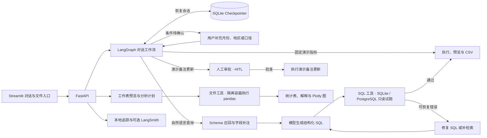

# 见数 · Text2SQL Agent

见数是一个面向结构化数据的问数助手。它用自然语言查询 SQLite 和只读 PostgreSQL，也能读取 CSV、XLSX 和 XLS，完成筛选、聚合、Top N、公式核对和绘图。查询结果带有可展开的 SQL，表格分析会显示工作表、筛选条件、参与行数和计算口径。

## 快速开始

安装 Docker Desktop，或准备带 Compose v2 的 Docker Engine。在项目目录启动服务。

```bash
docker compose up --build --wait
```

首次构建需要访问 Docker Hub、PyPI 和 Debian 软件源。启动后打开 [对话界面](http://127.0.0.1:8501) 或 [FastAPI 文档](http://127.0.0.1:8000/docs)。

内置电商演示使用 6 条合成订单，参考日期为 2026-11-10。下面的流程可以离线体验。

1. **查数和追问。** 输入「上月营收多少？」，回答「扣除退款」，再问「只看华南」。对应结果为 ¥475.00 和 ¥175.00。页面显示月份、地区和退款口径。
2. **审批。** 输入「将订单 1001 的备注改为已核对」，查看变更后点击「批准更新」。
3. **文件分析。** 切到「文件分析」，上传下面的 `sample.csv`。确认表头后问「有没有异常值并画图」，可以看到箱线图和疑似异常值 110。

```csv
amount
10
11
12
13
14
110
```

用 `docker compose down` 停止服务。默认 Compose 将界面和 API 发布到本机回环地址，状态存储在独立卷中。受控部署的配置见 [单机部署与恢复](docs/release.md)。

## 三分钟演示

在项目目录运行 `bash scripts/demo.sh`，然后打开 [独立演示界面](http://127.0.0.1:18501)。首次构建需下载镜像和依赖。默认可离线完成营收澄清、多级表头 Top N 和公式核对。用 `bash scripts/demo.sh live` 可追加一次真实模型 SQL 查询，在追踪里查看 token。停止演示用 `bash scripts/demo.sh stop`。

[观看三分钟演示](examples/demo/jianshu-demo.mp4) · [逐步演示与预期结果](docs/demo.md) · [下载示例工作簿](examples/demo/retail-demo.xlsx)

## 功能与边界

- **数据库问数。** 可查内置订单、挂载的 BIRD SQLite 或部署方配置的 PostgreSQL。支持同一数据范围内的追问、澄清、SQL 核对和 CSV 导出。外部数据库只读，演示订单备注更新需单独审批。PostgreSQL 可选表并查看结构，当前支持符合权限要求的普通表。
- **表格分析。** 可预览 CSV、XLSX、XLS，选定工作表和表头后做筛选、分组统计、Top N、图表与逐行公式核对。每次分析使用一张工作表。公式核对需要明确的单位及公式，或能从字段可靠推断。单文件上限 10 MiB。
- **结果核对。** 界面提供数据源、可解析的口径、执行阶段和模型用量。真实模型可能生成可执行但口径有误的 SQL，结果可结合 SQL、表结构和原始数据复核。

## 技术栈

- **应用与交互**　Python 3.11、FastAPI、Uvicorn、Streamlit。工作流通过 NDJSON 推送处理阶段和最终结果。
- **Agent 编排与状态**　LangGraph、SQLite Checkpointer、Pydantic。状态图管理澄清、审批、SQL 校验与恢复，模型输出按结构化协议解析。
- **模型接入**　OpenAI 兼容 Chat Completions。Compose 配置密钥后默认使用 DeepSeek V4 Pro，可切换兼容模型。历史 BIRD 对照实验使用 `deepseek-flash`。
- **Schema RAG**　BM25、表名和字典值匹配、外键图最短路径、自动字段补注。可选 BGE-M3、Sentence Transformers 和 Chroma 做本地向量召回。
- **数据执行**　SQLite、PostgreSQL、Psycopg 3、pglast。只读连接和 `EXPLAIN` 试跑设有执行时限。表格侧使用 pandas、openpyxl、xlrd 与 Plotly。
- **部署与观测**　Docker Compose、Caddy、Unix socket 和 SQLite 追踪存储。可选 LangSmith 上报步骤耗时和模型用量。

## 工作机制



### 1. Schema RAG 与自动补注

系统把问题、业务证据和表列元数据用于召回。BM25 先选出 Top-4 表，随后根据表名、短字典值命中补入候选表，再沿声明外键补齐 JOIN 所需的桥接表。启用 BGE-M3 后，表文档和列文档分别向量检索，再按表去重并补充候选。

自动补注结合官方字段说明、本地有限样本的存储画像和查询相关性，帮助区分文本数字、日期编码、稀疏列和字段含义。参考 SQL 留在本地评分流程。详见 [Schema Linking](docs/v2-schema-linking.md)、[召回修复](docs/v2-schema-recall-fix.md) 和 [BGE-M3 与 Chroma](docs/v2-dense-schema.md)。

### 2. 可核对的 SQL 执行与恢复

模型返回单条 SQL。服务先验证 JSON 结构，再用对应数据库的 `EXPLAIN` 检查语法和表列引用，通过只读约束后才正式执行。可恢复错误按类型进入 SQL 修复或补检索，最多共享三次重试。重复错误、权限违规和超时会结束请求。

SQLite 查询由只读连接和 authorizer 约束。PostgreSQL 查询经语法树检查、选表范围校验、只读账号和事务约束，并使用服务端游标。两条路径共用执行时限、50 行预览、完整 CSV 快照和追踪。合法 SQL 仍可能产生语义错误，因此评测用参考结果单独计算执行准确率。详见 [试跑与纠错](docs/v3-step5-dry-run.md) 和 [PostgreSQL 连接器](docs/postgres.md)。

### 3. 多轮澄清与人工审批

待澄清时，「净营收」「扣除退款」「十月」等短答会补齐或更正原问题的条件。新的完整问题会结束旧澄清，用户也可以在界面取消。「每个月各地区的订单数」之后输入「只看十月」，会沿用订单数和分组，只调整月份。页面标明沿用的查询和已解析条件。独立营收问题缺少月份或退款口径时先澄清。演示库金额汇总统一以元展示。

LangGraph 把待处理状态写入 SQLite Checkpointer，后续请求按会话继续。演示订单备注更新要求匹配的审批编号和显式批准，备注变更与去重记录在同一事务提交。详见 [多轮会话与审批](docs/step6-conversation.md)。

### 4. 有执行边界的文件分析

上传后先预览工作表和原始行。多工作表文件先选表，预览会识别常见标题行并建议多级表头范围。布局有歧义时，确认后再执行。合并表头沿用对应的上层标签，数据区的空白继续作为缺失处理。

文件分析保存每个会话最近一次已提交的原文件、问题、布局和结果。打开原链接可恢复图表和下载入口，也可沿用文件继续分析。页面提供「移除已保存文件和结果」。

计划明确到列、操作和筛选条件，再交给隔离容器中的固定 pandas 操作。远程规划接收问题和结构元数据，原始文件和预览行在本地处理。常见的离线任务包括数值概况、异常值检查、字段明确的单年排名和部分公式核对。

- **筛选与 Top N**　先筛选，再进行明细排序或分组汇总。表和图使用同一份有序结果，页面显示参与行数、排名范围与返回条数。
- **数据质量**　按来源标记区分真实观测、估算填充和未确认。跨期覆盖分析报告样本进出、共同样本对照和固定样本趋势。
- **公式核对**　用明确的公式和单位逐行重算。标准人均、每百人和人口密度换算可由明确表头推断，单位缺失或冲突时先澄清。默认按显示精度判断舍入误差，也可在问题里指定「容差=0.05」。结果显示公式、单位、实质超差和舍入级差异。

工作容器无网络、使用只读根文件系统和非 root 用户，并限制 CPU、内存、进程数及运行时间。单文件上限 10 MiB，单工作表上限 10,000 数据行、50 列。详见 [文件分析](docs/step7-file-analysis.md)。

## 配置模型与数据库

把 `.env.example` 复制为 `.env`，填写 `LLM_API_KEY` 后重建或重启服务。Compose 使用 `RAG_LLM_MODEL` 选择模型。产品评测默认固定 DeepSeek V4 Pro，兼容端点通过 `LLM_BASE_URL` 配置。

PostgreSQL 可用 Compose 启动十表零售示例库，也可连接部署方授权的外部 schema。在侧栏浏览结构、查看示例值和选择查询范围。详见 [启动与配置](docs/postgres.md)。

按 [BIRD 数据来源与校验](data/bird/SOURCES.md) 准备数据库后，将 `dev_databases` 以只读方式挂载。

```bash
RAG_BIRD_DATA_DIR=/absolute/path/to/dev_databases \
  docker compose -f compose.yaml -f compose.bird.yaml up --build --wait
```

然后在对话侧栏切换数据源。向量召回需要安装 `requirements-dense.txt`，通过 `python -m evaluation.prepare_dense` 准备模型和索引。独立启动 API 时，可用 `RAG_DENSE_ROOT` 指向索引目录，使用 `RAG_BIRD_ROOT` 指定数据库目录。默认 Compose 使用 BM25 检索路径。

## 评测与复现

- **产品 SQL 执行准确率（EX）。** BIRD Mini-Dev 固定划分，每个版本三轮。开发集 50 题，旧版 **44%（40%–46%）**，当前版 **54%（52%–54%）**。留出集 200 题，旧版 **32.5%（30%–34%）**，当前版 **39.5%（38.5%–39.5%）**。括号内为实测范围。使用 DeepSeek V4 Pro、温度 0、BM25 与自动字段补注。[评测口径与复现](docs/ci.md#产品路径-bird-评测)
- **延迟与错误分类。** 当前版各轮单题 P95 的中位数为开发集 **9.00 秒**、留出集 **5.08 秒**，计时覆盖产品查询核心。留出集 200 题重复三轮，600 次请求中有 343 次结果不符、11 次 SQL 重试后仍报相同错误、7 次执行超时、4 次模型输出错误。多轮对话的轮次 P95 单独计为 **1.30 秒**。[评测细节](docs/ci.md#产品路径-bird-评测)
- **SQL 语义检查。** 14 道定向题中，规则拦下 5 个错误答案，也误拦了 1 个正确答案。149 条 BIRD 候选 SQL 的配对回放中，EX 无变化。[定向题与消融](docs/ci.md#消融与语义检查)
- **PostgreSQL 示例验收。** DeepSeek V4 Pro 在十表合成零售库上通过 10/10 道业务题，核对有序结果、选表范围、CSV 和追踪。[验收命令](docs/postgres.md#验收)
- **应用验收。** 宿主项目环境的 **164 项自动回归全部通过**。30 个合成会话通过真实模型和录制回放验收，覆盖 74 轮与 38 个显式槽位断言。20 个表头布局用例中，12 个正确解析、8 个明确阻止执行。

```bash
python3.11 -m venv .venv
.venv/bin/python -m pip install -r requirements.txt -r requirements-step7.txt -r requirements-step8.txt
.venv/bin/python -m unittest discover -s tests -v
docker compose build sandbox-image
.venv/bin/python -m evaluation.run_file_selection
```

准备 BIRD 数据和模型配置后，运行 `python -m evaluation.run_product --split dev` 评测 50 道开发题，或用 `--split eval` 评测 200 道留出题。运行配置和逐题日志保存在本机 `evaluation/results/`。

## API 与文档

- `POST /api/v1/chat` 对话查数、澄清与审批申请，`GET /api/v1/sessions/{id}` 读取当前会话状态。
- `GET /api/v1/sessions/{id}/messages` 读取会话历史，每页默认 20 轮。响应中的 `next_before` 可作为下一次请求的 `before` 参数读取更早的消息。已登录环境按账号隔离，同一账号可用原链接在其他浏览器继续对话。
- `POST /api/v1/query` 执行指定数据库的只读问数，`POST /api/v1/approvals` 提交显式审批决定。
- `GET /api/v1/databases/postgres/schema` 查看 PostgreSQL 表结构。对话和查询可用 `tables` 指定表范围。
- SQL 查询返回预览和 `total_rows`。`GET /api/v1/results/{trace_id}/csv` 下载同次执行的完整结果，按原查询的行数和排序导出。导出按账号隔离，最多保留 24 小时。超过执行或 8 MiB 导出上限时，页面提示缩小范围。
- `POST /api/v1/files/preview` 预览，`POST /api/v1/files` 执行分析。两个入口使用相同的 `sheet`、`header_row` 和 `header_depth`。
- `POST /api/v1/files` 带 `session_id` 时保存本次文件分析。`GET /api/v1/sessions/{id}/file-analysis` 恢复最新结果，`DELETE` 删除保存的文件和结果。
- `GET /api/v1/traces/{id}` 查看耗时、执行步骤和 token。可通过 `RAG_LANGSMITH_EXPORT=true` 启用 LangSmith，导出步骤关系、时间和用量。

实现入口和数据边界详见 [系统架构](docs/architecture.md)。HTTPS、账号隔离、状态备份与回退见 [单机部署与恢复](docs/release.md)。

本机回归命令、GitHub Actions 检查和夜间真实模型任务见 [持续集成与评测](docs/ci.md)。
