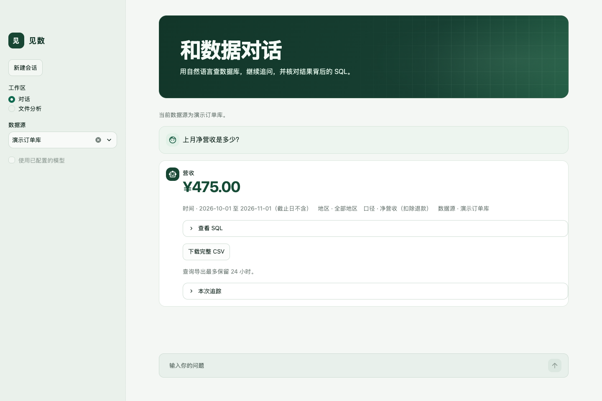
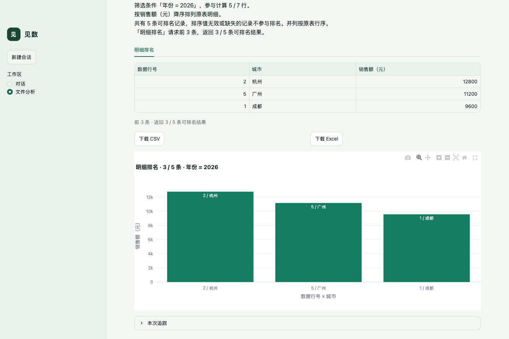
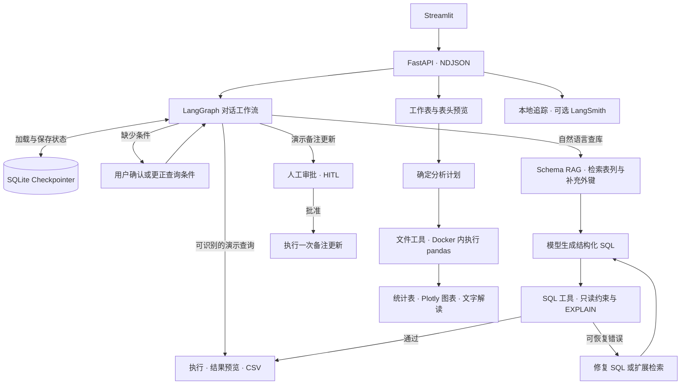

# 见数 · Text2SQL Agent

用自然语言查询数据库，或上传一份 Excel 直接做分析。见数会在问题缺少时间、地区或指标口径时先确认条件，然后执行查询，给出可核对的 SQL、统计表和图表。也可以在同一会话里继续追问、调整筛选条件或下载结果。

[三分钟演示视频](examples/demo/jianshu-demo.mp4) · [示例工作簿](examples/demo/retail-demo.xlsx) · [逐步演示](docs/demo.md) · [快速启动](#快速启动) · [评测与复现](#评测与复现)



## 两个工作区

### 数据库问数

- **查询、澄清和追问。** 在演示库里问「9 月营收是多少？」。见数会确认退款口径。此时回复「十月」可更正月份，再回复「净营收」得到 **¥475.00**。继续问「只看华南」，得到 **¥175.00**，页面会标明沿用的月份、口径和本轮地区。新会话可直接点击「上月净营收」「各地区订单数」或「上月退款总额」体验。
- **结果可核对。** 每轮展示已解析的时间、地区和指标口径。可查看生成的 SQL、结果预览、模型用量和执行阶段，也可下载同次查询的完整 CSV。新问题会结束旧澄清，独立查询缺少时间时会明确确认。刷新后可恢复会话与审批状态。
- **可选数据源和表范围。** 内置订单库可以离线演示。也可挂载 BIRD SQLite 数据库，或接入部署方配置的只读 PostgreSQL。PostgreSQL 工作区可浏览表结构、选择本次可查的表；换数据源或表范围时，后续查询使用新范围。
- **写操作经人工审批。** 试试「将订单 1001 的备注改为已核对」。先查看变更内容，再批准或拒绝。这个写入入口仅用于演示订单备注。外部 SQLite 和 PostgreSQL 问数始终只读。

### 文件分析



- **先确认读入方式。** 上传 CSV、XLSX 或 XLS 后先预览。Excel 支持选择工作表和确认表头范围，适配标题行、多级表头和合并表头。布局有歧义时先要求确认，数据区的空值按缺失处理。
- **筛选、分组、排名与绘图。** 在示例工作簿的「城市营收」选第 2–3 行为表头，问「2026 年销售额最高的 3 个城市并画图」。系统先筛出 5 条 2026 年记录，再返回杭州 **12,800 元**、广州 **11,200 元**和成都 **9,600 元**。表和图使用同一排序。也可问「有没有异常值并画图」，查看疑似异常点和判定方法。
- **逐行重算公式。** 在「公式核对」工作表选第 2 行为表头，输入「核对公式：人均收入 = 收入 / 人口」。系统以元/人重算 6 行，报告南京原值 **285 元/人**、重算值 **280 元/人**，以及 1 行实质超差、4 行舍入级差异、1 行完全一致。可在问题里指定 `容差=0.05`。
- **分析填充来源与样本覆盖。** 有显式来源标记时，可按年份或地区统计观测、估算填充和来源未确认的比例。跨期比较可列出新增、退出和共同样本，使用同一批样本对照前后变化。
- **保存结果供继续分析。** 结果表支持 CSV 和 Excel 下载，Plotly 图表可交互查看。每个会话保留最近一次已受理分析的文件、问题、布局和结果，刷新后可恢复，也可在界面删除保存内容。每次分析使用一张工作表，文件上限 10 MiB，每张表最多 10,000 个数据行和 50 列。

## 快速启动

需要 Docker Desktop 或带 Compose v2 的 Docker Engine。首次构建需要联网下载镜像和依赖。

```bash
git clone https://github.com/15016623369a-spe/text2sql-agent.git
cd text2sql-agent
bash scripts/demo.sh
```

打开 [演示界面](http://127.0.0.1:18501) 或 [演示 API 文档](http://127.0.0.1:18000/docs)。演示使用独立端口和状态卷，内置 6 条合成订单，参考日期为 2026-11-10。示例营收、多级表头 Top N 和公式核对均可在服务启动后离线完成。用 `bash scripts/demo.sh stop` 停止演示。

配置模型后，可以用 `bash scripts/demo.sh live` 启动在线演示。问「列出订单编号、地区和下单日期，按订单编号升序排列」，展开「本次追踪」查看模型调用、SQL 试跑和 token。固定营收案例由本地逻辑执行，模型调用次数和 token 均为 0。[演示脚本与预期结果](docs/demo.md)

## 技术栈

- **前端与 API**　Streamlit、Plotly、FastAPI、Uvicorn。API 用 NDJSON 流式返回执行阶段和最终结果。
- **Agent 与模型**　LangGraph、SQLite Checkpointer、Pydantic、OpenAI 兼容 Chat Completions。容器默认配置 DeepSeek V4 Pro，支持兼容端点和模型。
- **Schema RAG**　BM25、表名和字典值匹配、外键图、自动字段补注。可选 BGE-M3、Sentence Transformers、Chroma。
- **执行层**　SQLite、PostgreSQL、Psycopg 3、pglast、pandas、openpyxl、xlrd。
- **部署与追踪**　Python 3.11、Docker Compose、Caddy、Unix socket、本地 SQLite 追踪及可选 LangSmith。

## 工作机制



### Schema RAG 让模型拿到相关结构

默认 SQLite 路径先用 BM25 召回 Top-4 表，再按表名和短字典值扩展候选，从声明的外键关系补齐 JOIN 所需的桥接表。BIRD 路径会用官方字段说明和有限的本地样本生成字段含义、值编码及存储格式补注，再按问题相关性和提示词预算筛选。参考 SQL 留在本地评分流程。

BIRD SQLite 路径可选 BGE-M3 + Chroma。表和列分别做向量召回，按表去重后最多补入两张候选，再补外键桥接表。早期独立召回实验中，200 道留出题的最终表覆盖率从 98.09% 升至 99.36%。该指标基于参考 SQL 的表读集。本文的产品执行准确率使用默认 BM25 路径。PostgreSQL 使用目录中的表列名称、类型、注释和外键做结构检索，并受选表范围约束。[召回策略](docs/v2-schema-linking.md) · [漏表修复](docs/v2-schema-recall-fix.md) · [自动补注](docs/v2-holdout-and-automation.md) · [向量检索对照](docs/v2-dense-schema.md)

### SQL 试跑与有上限的恢复

模型按结构化协议返回一条 SQL。应用验证输出结构、表范围和只读约束，用数据库的 `EXPLAIN` 检查语法和表列引用，通过后才执行。可恢复错误按类型修复 SQL 或扩展 Schema 检索，两条路径共享最多三次重试。重复错误、权限违规或超时会结束请求，并给出具体提示和追踪编号。

SQLite 通过只读连接和 authorizer 限制访问。PostgreSQL 通过语法树检查、选表范围、独立 reader 和只读事务约束执行。界面预览最多 50 行，未触及执行和导出上限时，可下载同次执行的完整 CSV，保留原顺序。CSV 上限为 8 MiB，保留 24 小时。规则型语义检查可拦截部分明显不符的结果。SQL 通过试跑后仍有可能算错，界面保留 SQL 和口径用于复核。[试跑与恢复](docs/v3-step5-dry-run.md) · [PostgreSQL 连接器](docs/postgres.md)

### 多轮状态和审批可恢复

LangGraph 保存已解析条件和待确认事项。短答可补齐或覆盖原条件，明确追问只修改用户指定的范围，新问题或用户取消可结束待确认状态。演示备注审批需要会话匹配及显式批准，变更与去重记录在同一事务写入。[多轮对话与审批](docs/step6-conversation.md)

### 文件规划与计算隔离

文件计划明确工作表、列、筛选和统计操作。常见任务可由本地逻辑规划。启用远程规划时发送问题和表结构，原始文件和预览行在本地处理。计算由容器内固定的 pandas 操作完成，公式用受限表达式重算。无法从字段确定公式或单位时先确认，结果中列出单位、容差和实际偏差。

文件计算容器以非 root 用户运行，关闭网络，使用只读根文件系统，限制 CPU、内存、进程数和执行时间。API 经 Unix socket 向启动服务提交任务。Docker socket 仅由启动服务持有。[文件分析与隔离](docs/step7-file-analysis.md)

### 可追踪的执行结果

API 为每次请求记录追踪编号、步骤、耗时、模型调用和 token。配置模型费率后可查看估算成本。可选 LangSmith 导出步骤关系、耗时与用量，原始 SQL、查询结果和上传文件不进入远程追踪。连续三次远程导出失败后暂停上报，本地继续记录。[架构与数据边界](docs/architecture.md) · [追踪配置](docs/release.md#错误和追踪)

## 评测与复现

**BIRD SQL 执行准确率（EX）。** 使用固定 BIRD Mini-Dev 划分和 DeepSeek V4 Pro（温度 0），每个配置对同一批题运行三次。EX 比较实际执行结果与参考结果的类型化行集合，执行失败和未答题计入分母。旧版为加入值编码线索、产品 SQL 提示和语义检查之前的产品路径。括号内为三次观测范围。

- **开发集 50 题**　旧版中位数 **44%（40%–46%）**，当前版 **54%（52%–54%）**，提升 **10 个百分点**。
- **留出集 200 题**　旧版中位数 **32.5%（30%–34%）**，当前版 **39.5%（38.5%–39.5%）**，提升 **7 个百分点**。
- **延迟与 token**　开发集单题 P95 的三轮中位数由 **6.59 秒**升至 **9.00 秒**，留出集由 **4.50 秒**升至 **5.08 秒**。开发集每轮总 token 中位数由 **60,418** 增至 **73,709**，平均到每题约增加 **266 token**。留出集 600 次执行里，343 次结果与参考不符。
- **消融和语义检查**　开发集关闭产品 SQL 提示后，完整配置的 EX 中位数高 **4 个百分点**，三次配对差值为 +4 至 +6 个百分点。值编码线索对应 **+2 个百分点**，三次配对差值为 −2 至 +2 个百分点。149 条同 SQL 配对回放中，语义检查未改变 EX。另有 14 道定向题，规则拦下 5 个错误答案，也误拦了 1 个正确答案。

[完整统计、消融方法和误差分类](docs/ci.md#产品路径-bird-评测) · [冻结开发集基准](evaluation/baselines/product_dev.json)

**产品回归。** 发布前宿主环境通过 164 项自动回归。30 个合成对话覆盖 74 轮和 38 个显式槽位断言。20 个表头布局用例中，12 个正确解析，8 个明确阻止错误布局执行。DeepSeek V4 Pro 在十表 PostgreSQL 示例库通过 10/10 道业务题，核对了有序结果、选表范围、CSV 和追踪。GitHub Actions 提交检查覆盖宿主测试、真实文件容器、对话回放、浏览器冒烟和 PostgreSQL。配置模型密钥后，夜间任务按三次中位数检查开发集正确题数和 P95。[持续集成与夜间门禁](docs/ci.md) · [PostgreSQL 验收](docs/postgres.md#验收)

```bash
python3.11 -m venv .venv
.venv/bin/python -m pip install -r requirements.txt -r requirements-step7.txt -r requirements-step8.txt
.venv/bin/python -m unittest discover -s tests -v
```

准备 [BIRD 数据](data/bird/SOURCES.md) 和模型配置后，用产品入口复跑两组题。逐题日志、提示词和数据指纹、token 与延迟摘要存入本机 `evaluation/results/`。

```bash
.venv/bin/python -m evaluation.run_product --env-file .env --split dev
.venv/bin/python -m evaluation.run_product --env-file .env --split eval --workers 5
```

## 本地服务与部署

### 启动完整服务

```bash
cp .env.example .env
# 可在 .env 中填写 LLM_API_KEY，默认容器模型为 deepseek-v4-pro。
docker compose up --build --wait
```

默认发布到本机回环地址。打开 [Streamlit 界面](http://127.0.0.1:8501) 和 [FastAPI 文档](http://127.0.0.1:8000/docs)。`LLM_PROVIDER` 和 `LLM_BASE_URL` 选择供应商及兼容端点，`RAG_LLM_MODEL` 覆盖 Compose 模型。状态保存于 Docker 卷。用 `docker compose down` 停止服务。

### 接入外部数据

- **PostgreSQL**　按 [连接器文档](docs/postgres.md) 启动十表零售示例，或配置外部地址、数据库、schema 与独立 reader 账号。正式部署使用 `verify-full` 验证服务端证书和主机名。应用限制在经授权的普通表和已选范围内。BIRD 和 PostgreSQL 自然语言查数需要配置模型。
- **BIRD SQLite**　按 [数据来源与校验](data/bird/SOURCES.md) 准备数据库，用下面的命令只读挂载。在对话侧栏切换数据源。

```bash
RAG_BIRD_DATA_DIR=/absolute/path/to/dev_databases \
  docker compose -f compose.yaml -f compose.bird.yaml up --build --wait
```

- **可选向量索引**　安装 `requirements-dense.txt`，运行 `python -m evaluation.prepare_dense`。独立运行 API 时可通过 `RAG_DENSE_ROOT` 指向索引目录、`RAG_BIRD_ROOT` 指向数据库目录。[索引构建和评测](docs/v2-dense-schema.md)

### 单机受控部署

生产 Compose 通过 Caddy 提供 HTTPS 和账号认证，API 和界面由网关代理。会话、演示库、上传分析、审批、CSV 和追踪按账号隔离。部署文档提供账号配置、独立 reader 校验、镜像扫描记录、状态卷备份和回退流程。上线验收以目标环境的证书、容量和备份恢复结果为准。[单机部署与恢复](docs/release.md)

## API 索引

- `POST /api/v1/chat` 处理对话、澄清和审批申请，`GET /api/v1/sessions/{id}` 读取会话状态，`GET /api/v1/sessions/{id}/messages` 分页读取历史。
- `GET /api/v1/databases` 列出数据源，`GET /api/v1/databases/postgres/schema` 浏览结构，`POST /api/v1/query` 直接提交只读问数。
- `POST /api/v1/approvals` 提交演示备注的批准或拒绝。
- `POST /api/v1/files/preview` 预览文件，`POST /api/v1/files` 提交分析。两个入口接收 `application/octet-stream` 文件字节，共享 `sheet`、`header_row` 和 `header_depth`。用 `GET /api/v1/sessions/{id}/file-analysis` 恢复最近一次分析，用 `DELETE` 删除。
- `GET /api/v1/results/{trace_id}/csv` 下载查询快照，`GET /api/v1/traces/{id}` 查看追踪，`GET /healthz` 检查服务状态。

用独立演示的 API 发送一条离线问题。继续对话时复用同一 `session_id`。

```bash
curl -NsS http://127.0.0.1:18000/api/v1/chat \
  -H 'Content-Type: application/json' \
  --data '{"session_id":"f1461498-8902-4678-ac42-36dc38025d65","question":"一共有多少笔订单？"}'
```

响应逐行返回处理事件，`result` 事件包含结果，`trace_id` 可用于查询追踪记录。

[系统架构](docs/architecture.md) · [文件分析](docs/step7-file-analysis.md) · [部署手册](docs/release.md) · [完整评测](docs/ci.md)
