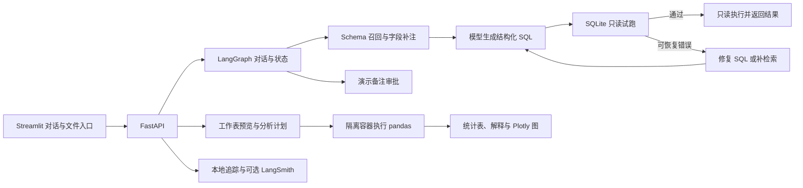

# 见数 · Text2SQL Agent

见数是一个面向结构化数据的问数助手。它用自然语言查询 SQLite，也能读取 CSV、XLSX 和 XLS，完成筛选、聚合、Top N、公式核对和绘图。查询结果带有可展开的 SQL，表格分析会显示工作表、筛选条件、参与行数和计算口径。

## 快速开始

安装 Docker Desktop，或准备带 Compose v2 的 Docker Engine。在项目目录启动服务。

```bash
docker compose up --build --wait
```

首次构建需要访问 Docker Hub、PyPI 和 Debian 软件源。启动后打开 [对话界面](http://127.0.0.1:8501) 或 [FastAPI 文档](http://127.0.0.1:8000/docs)。

内置电商演示使用 6 条合成订单，参考日期为 2026-11-10。下面的流程可以离线体验。

1. **查数和追问。** 输入「上月营收多少？」，回答「扣除退款」，再问「那华南呢？」。对应结果为 ¥475.00 和 ¥175.00。页面显示月份、地区和退款口径。
2. **审批。** 输入「将订单 1001 的备注改为已核对」，查看变更后点击「批准更新」。
3. **文件分析。** 切到「文件分析」，上传下面的 `sample.csv`。确认表头后问「有没有异常值并画图」，可以看到箱线图和疑似异常值 110。

```csv
amount
10
11
12
13
14
110
```

用 `docker compose down` 停止服务。默认 Compose 将界面和 API 发布到本机回环地址，状态存储在独立卷中。受控部署的配置见 [单机部署与恢复](docs/release.md)。

## 技术栈

- **应用与交互**　Python 3.11、FastAPI、Uvicorn、Streamlit。工作流通过 NDJSON 推送处理阶段和最终结果。
- **Agent 编排与状态**　LangGraph、SQLite Checkpointer、Pydantic。状态图管理澄清、审批、SQL 校验与恢复，模型输出按结构化协议解析。
- **模型接入**　OpenAI 兼容 Chat Completions。Compose 配置密钥后默认使用 DeepSeek V4 Pro，可切换兼容模型。历史 BIRD 对照实验使用 `deepseek-flash`。
- **Schema RAG**　BM25、表名和字典值匹配、外键图最短路径、自动字段补注。可选 BGE-M3、Sentence Transformers 和 Chroma 做本地向量召回。
- **数据执行**　SQLite 只读连接、`EXPLAIN` 试跑和执行超时。表格侧使用 pandas、openpyxl、xlrd 与 Plotly。
- **部署与观测**　Docker Compose、Caddy、Unix socket 和 SQLite 追踪存储。可选 LangSmith 上报步骤耗时和模型用量。

## 工作机制



### 1. Schema RAG 与自动补注

系统把问题、业务证据和表列元数据用于召回。BM25 先选出 Top-4 表，随后根据表名、短字典值命中补入候选表，再沿声明外键补齐 JOIN 所需的桥接表。启用 BGE-M3 后，表文档和列文档分别向量检索，再按表去重并补充候选。

自动补注结合官方字段说明、本地有限样本的存储画像和查询相关性，帮助区分文本数字、日期编码、稀疏列和字段含义。参考 SQL 留在本地评分流程。详见 [Schema Linking](docs/v2-schema-linking.md)、[召回修复](docs/v2-schema-recall-fix.md) 和 [BGE-M3 与 Chroma](docs/v2-dense-schema.md)。

### 2. 可核对的 SQL 执行与恢复

模型返回单条 SQL。服务先验证 JSON 结构，再用 SQLite `EXPLAIN` 检查语法、表列引用和只读权限，通过后才正式执行。可恢复错误按类型进入 SQL 修复或补检索，最多共享三次重试。重复错误、权限违规和超时会结束请求。

正式查询使用只读连接、SQLite authorizer 和执行时限。交互界面最多展示 50 行结果，并提供实际执行的 SQL。合法 SQL 仍可能产生语义错误，因此评测用参考结果单独计算执行准确率。详见 [试跑与纠错](docs/v3-step5-dry-run.md)。

### 3. 多轮澄清与人工审批

待澄清时，「净营收」「扣除退款」「十月」等短答优先补回原问题。明确的追问可以继承已确认条件，独立营收问题缺少月份或退款口径时先澄清。演示营收查询用固定 SQL 模板执行，结果展示时间、地区和口径。

LangGraph 把待处理状态写入 SQLite Checkpointer，后续请求按会话继续。演示订单备注更新要求匹配的审批编号和显式批准，备注变更与去重记录在同一事务提交。详见 [多轮会话与审批](docs/step6-conversation.md)。

### 4. 有执行边界的文件分析

上传后先预览工作表和原始行。多工作表文件先选表，标题行和多级表头可通过表头起始行及表头深度调整。合并表头尝试沿用上层标签，数据区的空白继续作为缺失处理。

计划明确到列、操作和筛选条件，再交给隔离容器中的固定 pandas 操作。远程规划接收问题和结构元数据，原始文件和预览行在本地处理。常见的离线任务包括数值概况、异常值检查、字段明确的单年排名和部分公式核对。

- **筛选与 Top N**　先筛选，再进行明细排序或分组汇总。表和图使用同一份有序结果，页面显示参与行数、排名范围与返回条数。
- **数据质量**　按来源标记区分真实观测、估算填充和未确认。跨期覆盖分析报告样本进出、共同样本对照和固定样本趋势。
- **公式核对**　用明确的公式和单位逐行重算。标准人均、每百人换算可由明确表头推断，单位缺失或冲突时先澄清。结果显示核对行数、误差、单位与依据。

工作容器无网络、使用只读根文件系统和非 root 用户，并限制 CPU、内存、进程数及运行时间。单文件上限 10 MiB，单工作表上限 10,000 数据行、50 列。详见 [文件分析](docs/step7-file-analysis.md)。

## 配置模型与数据库

把 `.env.example` 复制为 `.env`，填写 `LLM_API_KEY` 后重建或重启服务。Compose 使用 `RAG_LLM_MODEL` 选择模型，独立评测脚本使用 `LLM_MODEL`。兼容端点通过 `LLM_BASE_URL` 配置。

按 [BIRD 数据来源与校验](data/bird/SOURCES.md) 准备数据库后，将 `dev_databases` 以只读方式挂载。

```bash
RAG_BIRD_DATA_DIR=/absolute/path/to/dev_databases \
  docker compose -f compose.yaml -f compose.bird.yaml up --build --wait
```

然后在对话侧栏切换数据源。向量召回需要安装 `requirements-dense.txt`，通过 `python -m evaluation.prepare_dense` 准备模型和索引。独立启动 API 时，可用 `RAG_DENSE_ROOT` 指向索引目录，使用 `RAG_BIRD_ROOT` 指定数据库目录。默认 Compose 使用 BM25 检索路径。

## 评测与复现

- **Schema 召回。** BIRD Mini-Dev 的 200 道留出题上，默认候选扩展将最终表召回从 **94.48% 提升到 98.09%**，漏表题从 **23 道降到 8 道**。同一留出集增加 BGE-M3/Chroma 后，最终表召回为 **99.36%**，漏表题降到 **3 道**。留出集和开发集使用同一批数据库。[检索对照](docs/v2-schema-recall-fix.md) · [向量对照](docs/v2-dense-schema.md)
- **SQL 恢复。** 50 道开发题的试跑对照中，V2 和 V3 的 EX 均为 **26/50**。V3 把一条语法错误的 SQL 恢复到可执行，定向重放另验证了缺列修复可恢复正确结果。[试跑实验](docs/v3-step5-dry-run.md)
- **应用验收。** 当前版本通过 **78 项自动回归**。文件专项包含 **15 道合成用例**，覆盖过滤、分组排名、图表一致性、无匹配和条件缺失等场景。

```bash
python3.11 -m venv .venv
.venv/bin/python -m pip install -r requirements.txt -r requirements-step7.txt -r requirements-step8.txt
.venv/bin/python -m unittest discover -s tests -v
docker compose build sandbox-image
.venv/bin/python -m evaluation.run_file_selection
```

准备 BIRD 数据后，可运行 `python -m evaluation.run_schema_recall --split eval` 做离线召回评测，或配置模型后运行 `python -m evaluation.run_v3 --split dev --auto-column-notes` 做执行评测。运行配置和逐题日志保存在本机 `evaluation/results/`。

## API 与文档

- `POST /api/v1/chat` 对话查数、澄清与审批申请，`GET /api/v1/sessions/{id}` 读取当前会话状态。
- `POST /api/v1/query` 执行指定数据库的只读问数，`POST /api/v1/approvals` 提交显式审批决定。
- `POST /api/v1/files/preview` 预览，`POST /api/v1/files` 执行分析。两个入口使用相同的 `sheet`、`header_row` 和 `header_depth`。
- `GET /api/v1/traces/{id}` 查看耗时、执行步骤和 token。可通过 `RAG_LANGSMITH_EXPORT=true` 启用 LangSmith，导出步骤关系、时间和用量。

实现入口和数据边界详见 [系统架构](docs/architecture.md)。HTTPS、账号隔离、状态备份与回退见 [单机部署与恢复](docs/release.md)。
